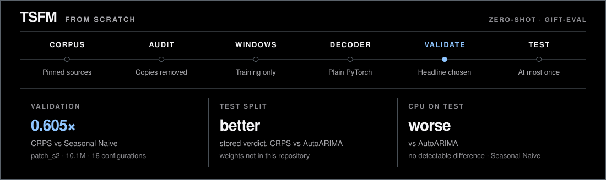
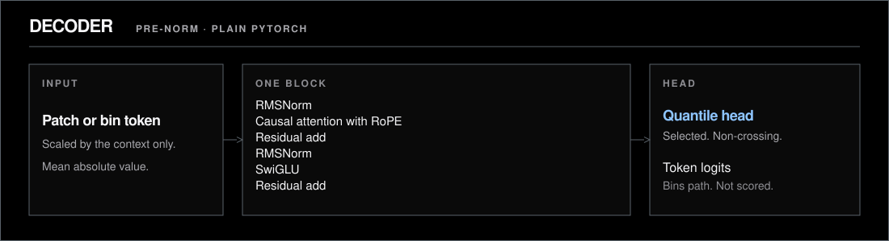
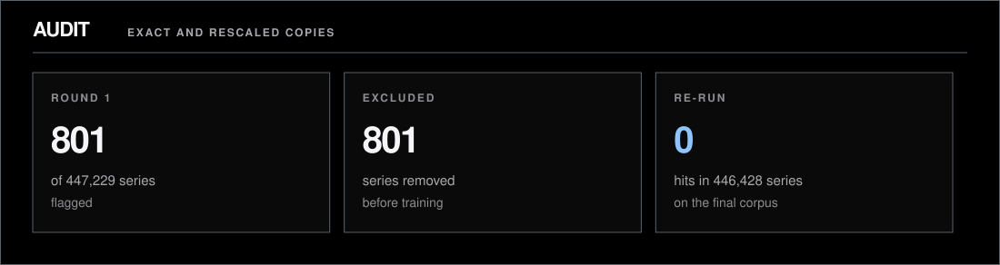

<!-- GENERATED by `tsfm docs build` from docs_templates/README.md. Do not edit by hand. -->
# tsfm

**A time-series foundation model, written and pretrained from scratch.** A decoder-only transformer in plain PyTorch, pretrained on a pinned corpus and scored zero-shot on GIFT-Eval under a protocol tagged in git before the test split was opened.

**[Case study](https://shmorsi.github.io/projects/tsfm.html)** · [Portfolio](https://shmorsi.github.io/) · [Research note](RESEARCH_NOTE.md) · [Model card](MODEL_CARD.md) · [Data card](DATA_CARD.md)

[](https://github.com/shmorsi/tsfm-from-scratch/actions/workflows/ci.yml)
[](LICENSE)
[](pyproject.toml)
[](https://colab.research.google.com/github/shmorsi/tsfm-from-scratch/blob/main/notebooks/score_patch_s2_test.ipynb)



## Key results

* **Zero-shot forecasting.** `patch_s2` (10.1M parameters) scores test CRPS 0.688× upstream AutoARIMA (95% CI [0.624, 0.757], better), the pre-registered primary comparison. It was selected on validation, where its CRPS was 0.605× Seasonal Naive.
* **Benchmark leakage found.** The public pretraining corpus contained copies of GIFT-Eval series. A content audit flagged 801 of 447,229 series; all were excluded, and a re-check flags 0.
* **A gated test split.** `tsfm eval` refuses a model test score unless the `prereg-v1` tag is in the commit's history, and refuses a second one.

| model | parameters | split | seeds | CRPS vs Seasonal Naive [95% CI] | CRPS vs AutoARIMA [95% CI] (primary) |
|---|---|---|---|---|---|
| `patch_s2` (T4) | 10,083,392 | validation, 16 configurations | 1 | 0.605 (no interval computed) | AutoARIMA not run on validation |
| `patch_s2` (T4) | 10,083,392 | test, 97 configurations | 1 | 0.628 [0.569, 0.692], better | 0.688 [0.624, 0.757], better |
| `cpu_s0` (CPU) | 833,440 | test, 97 configurations | 3 | 1.109 [0.978, 1.265], no detectable difference | 1.217 [1.091, 1.362], worse |

Lower is better; 1 equals the reference. Verdicts follow the pre-registered rule: better if the interval is entirely below 1, worse if entirely above, otherwise no detectable difference. **Caveat:** the `patch_s2` test score is one seed, so its interval covers configurations, not training seeds, and its weights are not in this repository. The small CPU model that is committed is worse than AutoARIMA.

## How it works



Decoder-only, pre-norm, in plain PyTorch: RMSNorm, rotary positions, SwiGLU, a key/value cache, and a non-crossing quantile head. A second tokenizer quantises the scaled series into a fixed vocabulary and is trained with cross-entropy. The head that was selected is the patch head. Details are in `MODEL_CARD.md`.

* **Data.** A pinned subset of GiftEvalPretrain, whole datasets held out for validation, plus Gaussian-process series. A content check removed exact and rescaled copies of GIFT-Eval series (`DATA_CARD.md`).
* **Committed CPU model.** Patch length 16, horizon 32, width 128, 4 layers and 4 heads. Training is 2,000 steps, batch 32, fp32. Seed 0 finished in 70.7 seconds.
* **T4 headline.** `patch_s2` uses patch length 32 and a horizon of 64. The training loop supports mixed precision and resumable checkpoints.
* **Evaluation.** GluonTS, the same way upstream scores GIFT-Eval: MASE and quantile-loss CRPS, each divided by Seasonal Naive, geometric mean over configurations, plus 50/80/90% coverage. Our Seasonal Naive reproduces theirs on every configuration.

## Data integrity



The public pretraining corpus, described by its authors as non-leaking, contains copies of benchmark series, some inside the test windows. The audit finds exact and rescaled copies; `DATA_CARD.md` lists what was removed.

## Quick start

Python 3.12 and [uv](https://docs.astral.sh/uv/). From a fresh clone:

```bash
uv sync --locked --extra cpu
uv run pytest -m "not slow and not network and not data"
uv run tsfm pipeline --config configs/tiny_cpu.yaml
```

`uv sync --locked` installs the pinned lockfile, including the CPU PyTorch build. The pipeline downloads a small pinned data subset (network required), then trains and scores a tiny model. It writes to a temporary directory, outside `results/`.

## Repository map

```text
src/tsfm/model.py        decoder-only transformer: RMSNorm, RoPE, SwiGLU, KV cache, quantile head
src/tsfm/tokenizers.py   patch tokenizer and the fixed-vocabulary bins tokenizer
src/tsfm/train/          training loop, objectives, resumable checkpoints, GPU bench
src/tsfm/data/           pinned corpus download, conversion, synthetic series, leakage audit
src/tsfm/eval/           GIFT-Eval scoring (GluonTS), test-split gate, vendored upstream results
src/tsfm/calibrate.py    split-conformal intervals fit on validation only
src/tsfm/finance/        realized-volatility baselines (BTCUSDT, ETHUSDT)
src/tsfm/docs/           generator for this README, the cards, the note and the figures
configs/                 data, pilot, scaling and CPU-study configurations
results/                 every committed number the documents cite
locks/                   SHA-256 manifests for source data and the leakage exclusions
notebooks/               Colab notebooks (generated by scripts/make_colab_notebook.py)
tests/                   unit tests, including the guard against unbacked numbers
```

## Documents

| document | what it is |
|---|---|
| [RESEARCH_NOTE.md](RESEARCH_NOTE.md) | The study: question, data, method, results, scope |
| [MODEL_CARD.md](MODEL_CARD.md) | Models, intended use, metrics, compute |
| [DATA_CARD.md](DATA_CARD.md) | Corpus, held-out datasets, the leakage audit |
| [PREREGISTRATION.md](PREREGISTRATION.md) | T4 study protocol, tagged `prereg-v1` |
| [PREREGISTRATION_CPU.md](PREREGISTRATION_CPU.md) · [PREREGISTRATION_VOL.md](PREREGISTRATION_VOL.md) | CPU study and volatility-baseline protocols |
| [DEVIATIONS.md](DEVIATIONS.md) | What the compute budget cut from the plan |
| [DEVELOPMENT.md](DEVELOPMENT.md) | Checks, generated files, frozen records |
| [docs/COMMIT_MAP.md](docs/COMMIT_MAP.md) | Lookup from commit hashes recorded in older `results/` files to current ones |

## Full results

Every table below is rendered from `results/` by `tsfm docs build`. Click a heading to expand it.

<details>
<summary><b>Scaling and compute</b></summary>

Power-law fit L = a * C^(-b) over 3 runs: b = 0.0578 (95% bootstrap interval 0.0508 to 0.0636, paired over validation batches).

| run | body params | train FLOPs (6ND) | val loss |
|---|---|---|---|
| patch_s0 | 754,688 | 7.42e+13 | 0.2355 |
| patch_s1 | 2,656,512 | 8.36e+14 | 0.1975 |
| patch_s2 | 9,671,680 | 1.14e+16 | 0.1759 |


Training projection on one Tesla T4 (`results/bench/Tesla_T4.json`), from 10 measured steps per configuration. `projected_hours` is the stored field. This is not a test-split scoring time.

| config | configured steps | parameters | precision | seconds/step | projected hours | peak GB | TFLOP/s |
|---|---|---|---|---|---|---|---|
| `bins_s2.yaml` | 800 | 12,293,440 | fp16 | 4.281 | 0.95 | 11.93 | 3.55 |
| `patch_s0.yaml` | 1,000 | 895,296 | fp16 | 0.618 | 0.17 | 0.48 | 0.12 |
| `patch_s1.yaml` | 3,200 | 2,879,296 | fp16 | 0.283 | 0.25 | 0.79 | 0.92 |
| `patch_s2.yaml` | 12,000 | 10,083,392 | fp16 | 0.386 | 1.29 | 1.52 | 2.46 |
| `patch_s3.yaml` | 38,400 | 31,896,384 | fp16 | 0.672 | 7.17 | 1.80 | 4.55 |
| `patch_s4.yaml` | 121,000 | 100,442,944 | fp16 | 1.173 | 39.43 | 4.21 | 8.31 |

`DEVIATIONS.md` records which of these configurations were not trained. The bench is not a forecast of the test-split score.

</details>

<details>
<summary><b>Test split, <code>patch_s2</code></b></summary>

Scored once from its Drive checkpoint (`notebooks/score_patch_s2_test.ipynb`), one seed, the settings fixed in `PREREGISTRATION.md`. The first row is the pre-registered primary comparison.

| model | vs | metric | ratio | 95% CI | verdict |
|---|---|---|---|---|---|
| headline | upstream:Auto_Arima | crps | 0.688 | [0.624, 0.757] | better |
| headline | upstream:Auto_Arima | mase | 0.851 | [0.684, 0.986] | better |
| headline | seasonal_naive | crps | 0.628 | [0.569, 0.692] | better |
| headline | seasonal_naive | mase | 0.914 | [0.848, 0.989] | better |

</details>

<details>
<summary><b>Test split, committed CPU model, and calibration</b></summary>

On the frozen test split, the committed CPU model (833,440 parameters, 3 seeds, 97 configurations) has CRPS 1.109× Seasonal Naive (95% CI over configurations [0.978, 1.265]: no detectable difference) and 1.217× upstream AutoARIMA (95% CI [1.091, 1.362]: worse). MASE is 1.835× Seasonal Naive (95% CI [1.565, 2.173]: worse).


Nominal coverage against empirical coverage on the test split, after averaging the three seeds. Raw quantiles cover 0.401 / 0.642 / 0.730 at the 50/80/90% levels. Split-conformal adjustment, fit on the validation split only, covers 0.713 / 0.932 / 0.975. A calibrated model would sit on the diagonal. The conformal 80% point is above the diagonal, and the CRPS comparison below is worse.

Official GIFT-Eval test split, 97 configurations, 3 seeds. MASE and CRPS are geometric means of each score divided by Seasonal Naive. The interval next to the ratio is a 95% paired bootstrap over configurations of the seed-averaged scores (10,000 resamples). The other interval is a 95% Student-t interval across seed-level CRPS ratios; with three seeds it is wide on purpose. Conformal expansions were fit on the validation split only. A ratio below 1 is better than Seasonal Naive.

| model | MASE | CRPS | CRPS ratio vs Seasonal Naive [95% config CI] | CRPS ratio across seeds [95% t CI] | 80% coverage | vs Seasonal Naive |
|---|---|---|---|---|---|---|
| cpu_s0, raw quantiles | 1.835 | 1.109 | 1.109 [0.978, 1.265] | [0.654, 1.516] | 0.642 | no detectable difference |
| cpu_s0, split-conformal | 1.835 | 1.277 | 1.277 [1.130, 1.455] | [0.603, 1.920] | 0.932 | worse |

Ratio of seed-averaged geometric means, model divided by upstream AutoARIMA, both already divided by Seasonal Naive. Below 1 would be better than AutoARIMA. The pre-registered decision rule: better if the interval is entirely below 1, worse if it is entirely above 1, otherwise no detectable difference.

| model | metric | ratio to AutoARIMA | 95% CI | verdict |
|---|---|---|---|---|
| cpu_s0 raw | crps | 1.217 | [1.091, 1.362] | worse |
| cpu_s0 raw | mase | 1.709 | [1.343, 2.088] | worse |
| cpu_s0 split-conformal | crps | 1.401 | [1.249, 1.576] | worse |
| cpu_s0 split-conformal | mase | 1.709 | [1.343, 2.088] | worse |

Conformal adjustment leaves MASE unchanged, because the median is not moved, and it makes CRPS worse. Reproduce the study on CPU (an eval that already has `all_results.csv` is skipped, so committed test scores are not recomputed):

```bash
uv run tsfm cpu-study --config configs/cpu_study.yaml
```

</details>

<details>
<summary><b>Validation split, the study that selected <code>patch_s2</code></b></summary>

The 0.605× Seasonal Naive CRPS for `patch_s2` is a validation result: 16 held-out configurations, one seed, 10,083,392 parameters. Its test score is in `results/analysis/headline.json`.

Three sizes, pretrained from scratch on a free Colab T4 and scored zero-shot on datasets held out of pretraining. This is how `patch_s2` was chosen; it is not a test-set result.

Validation split (16 configurations from datasets held out of pretraining); geometric means of scores divided by Seasonal Naive.

| model | MASE | CRPS | rank | 50% coverage | 80% coverage | 90% coverage |
|---|---|---|---|---|---|---|
| patch_s2 | 0.840 | 0.605 | 1.62 | 0.365 | 0.649 | 0.770 |
| patch_s1 | 0.910 | 0.636 | 2.06 | 0.416 | 0.694 | 0.806 |
| pilot_patch_s0_cpu | 1.123 | 0.733 | 3.75 | 0.390 | 0.685 | 0.801 |
| patch_s0 | 1.139 | 0.740 | 3.38 | 0.396 | 0.686 | 0.800 |
| seasonal_naive | 1.000 | 1.000 | 4.19 | 0.711 | 0.857 | 0.904 |

The CPU study's own validation numbers, used to fit conformal intervals and to compare positional encodings:

Validation split used only for the conformal fit and this ablation (14 configurations from the ten held-out datasets; synthetic validation series are not included). The split-conformal row is scored on the same forecasts the expansions were fit on, so its coverage is not a held-out check. The test table is the held-out calibration result.

| model | MASE | CRPS | CRPS ratio vs Seasonal Naive [95% config CI] | CRPS ratio across seeds [95% t CI] | 80% coverage | vs Seasonal Naive |
|---|---|---|---|---|---|---|
| cpu_s0, raw | 1.312 | 0.988 | 0.988 [0.729, 1.353] | [0.658, 1.277] | 0.692 | no detectable difference |
| cpu_s0, split-conformal | 1.312 | 1.132 | 1.132 [0.816, 1.547] | [0.567, 1.673] | 0.948 | no detectable difference |

Positional encoding, seed 0, same 14 validation configurations: RoPE CRPS 0.853 and MASE 1.146; no positions CRPS 0.921 and MASE 1.232. The no-position run was not scored on the test split.

</details>

<details>
<summary><b>Published reference points (other models)</b></summary>

Recomputed from upstream's committed GIFT-Eval result files, plus our Seasonal Naive and `patch_s2` runs. The other rows are other people's models.

GIFT-Eval test split, 97 configurations; geometric mean of each metric divided by Seasonal Naive (lower is better). All rows except ours and Seasonal Naive are computed from upstream's committed result files; coverage needs quantiles those files do not contain.

| model | MASE | CRPS | rank | 80% coverage |
|---|---|---|---|---|
| TimesFM-2.5 | 0.705 | 0.490 | 1.63 | n/a |
| FlowState-9.1M | 0.726 | 0.502 | 1.89 | n/a |
| **patch_s2 (ours, pretrained from scratch)** | 0.914 | 0.628 | 3.33 | 0.668 |
| Auto_Arima | 1.074 | 0.912 | 4.69 | n/a |
| Seasonal Naive (run by us) | 1.000 | 1.000 | 5.25 | 0.899 |
| Auto_Theta | 1.090 | 1.244 | 5.61 | n/a |
| Auto_ETS | 1.212 | 7.489 | 5.61 | n/a |

</details>

<details>
<summary><b>Seeds, conformal, positions, attention</b></summary>

Seed-averaged validation CRPS is 0.988× Seasonal Naive (14 configurations, 95% CI [0.729, 1.353]). The same statistic on the test split is 1.109×. The three seed-level test ratios are 0.935, 1.045 and 1.275. Their mean is 1.085, and the 95% Student-t interval on that mean is [0.654, 1.516]. That interval belongs to the mean of the three seed-level geometric means. It is not the interval on the seed-averaged ratio in the table, which is a paired bootstrap over configurations. I kept all three seeds.

Split conformal, one pooled expansion per seed fit only on validation, widens the intervals and pushes the test 80% coverage from 0.642 to 0.932, above the nominal 80% level. CRPS moves from 1.109 to 1.277 (worse than Seasonal Naive; the configuration interval is entirely above 1). Seed 0's expansions, in mean-absolute-scaled units, are 0.139 at 50%, 0.433 at 80% and 1.443 at 90%.

Turning rotary positions off, seed 0 only, on the same 14 validation configurations, moves CRPS from 0.853 to 0.921 and MASE from 1.146 to 1.232. That run was not scored on the test split.

On one held-out hourly series (`bdg-2_bear`, context 384 steps, patches of length 16), the last query puts 0.272 of its attention on the most recent patch and 0.581 on the last four. The peak is at lag 0 patches. Entropy is 2.568 nats against 3.178 for a uniform distribution over the patches. The mass is local. The series is hourly and each patch is 16 steps, so a day is not patch-aligned and I am not reading a daily cycle out of that peak.

</details>

<details>
<summary><b>Market volatility baselines</b></summary>

Daily realized volatility of BTCUSDT and ETHUSDT, 22-day forecasts, designed in `PREREGISTRATION_VOL.md`. Statistical forecast scores only; our model was not run on this study.

| model | origins | weighted quantile loss | ratio to random walk [95% CI] | 50% cov. | 80% cov. | 90% cov. |
|---|---|---|---|---|---|---|
| Random walk (reference) | 4,886 | 0.3557 | 1 (reference) | 0.505 | 0.799 | 0.896 |
| HAR-RV | 4,886 | 0.2687 | 0.755 [0.731, 0.783] | 0.536 | 0.810 | 0.899 |

</details>

## Reproducibility

* **Pre-registration.** `PREREGISTRATION.md` fixes the T4 study (tag `prereg-v1`), `PREREGISTRATION_CPU.md` the CPU study, `PREREGISTRATION_VOL.md` the volatility baselines.
* **Deviations.** `DEVIATIONS.md` records what the T4 budget cut: sizes and seeds not trained, and the bins tokenizer not scored.
* **Locks.** Manifests under `locks/` pin source files and the converted training data by SHA-256.
* **CI.** GitHub Actions runs ruff, the formatter, mypy, the unit tests, the tiny pipeline, and `tsfm docs check`.
* **Numbers.** `README.md`, the cards, the research note and `docs/figures/` are generated by `uv run tsfm docs build` from `docs_templates/` and `results/`. The check fails if a generated document shows a number that is not in `results/` or `docs_templates/allowed_numbers.txt`.

## Limitations

Beyond the caveat under Key results: the CPU model's CRPS against Seasonal Naive is not distinguishable from 1, raw intervals undercover, and pooled conformal overshoots and hurts CRPS. The leakage check finds exact and rescaled copies, not noisy or resampled ones. The scaling fit describes only the runs that were trained. Nothing here measures economic value.

## Next steps

Not yet built or run; none of this is a result.

* **Tokenization.** The bins head is the language-model path: a fixed vocabulary, sampled token by token. It was trained at the headline width and not scored (`DEVIATIONS.md`). I would finish that comparison before treating the patch head as the architecture.
* **LLM-style scaling.** The pre-registration named more sizes than a free T4 could train. I would add those runs and only then refit, rather than extrapolate the current fit.
* **Language-conditioned forecasting.** Condition the same decoder on a short text description of the series (domain, frequency), scored only under a new pre-registration.
* **Agents.** Expose the forecaster as a tool a caller can ask for a context, a frequency and a baseline, with every test score behind the same pre-registered gate.


## License

Code in this repository is Apache-2.0 (`LICENSE`). Cite it with `CITATION.cff`. Derived Binance volatility files under `results/finance/` carry the licence stated in `results/finance/README.md`.
