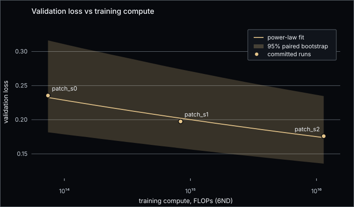
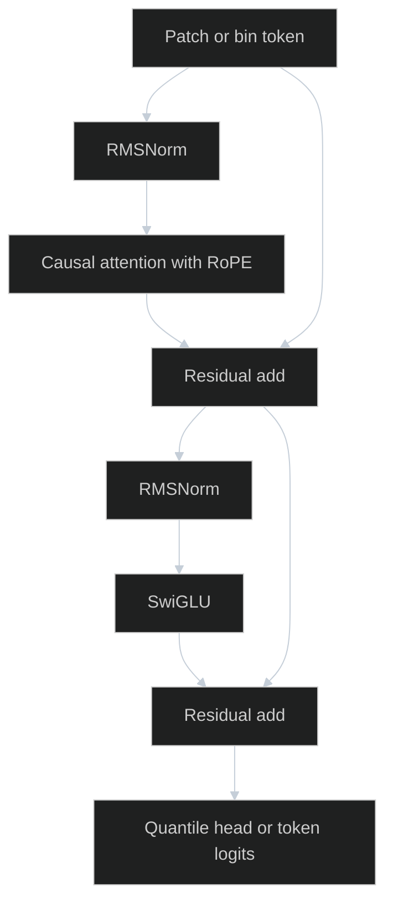
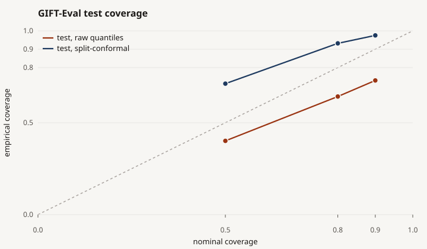

<!-- GENERATED by `tsfm docs build` from docs_templates/README.md. Do not edit by hand. -->
# tsfm

A time-series foundation model pretrained from scratch. A small transformer in plain PyTorch, on a pinned corpus, scored zero-shot on GIFT-Eval under rules fixed in a git tag before the test split was touched.

[](https://github.com/shmorsi/tsfm-from-scratch/actions/workflows/ci.yml)
[](LICENSE)
[](pyproject.toml)
[](https://colab.research.google.com/github/shmorsi/tsfm-from-scratch/blob/main/notebooks/score_patch_s2_test.ipynb)

[Case study](https://shmorsi.github.io/projects/tsfm.html) · [Research note](RESEARCH_NOTE.md) · [Data card](DATA_CARD.md) · [Model card](MODEL_CARD.md) · [Deviations](DEVIATIONS.md) · [Development](DEVELOPMENT.md)




## Key results

`patch_s2` (10.1M parameters) reaches CRPS 0.605× Seasonal Naive on the validation split (16 held-out configurations, one seed). Its test score is pending. The weights are not in this repository. Steps are under [Blocked on owner](#blocked-on-owner).

| model | parameters | split | seeds | CRPS vs Seasonal Naive [95% CI] | CRPS vs AutoARIMA [95% CI] (primary) |
|---|---|---|---|---|---|
| `patch_s2` (T4) | 10,083,392 | validation, 16 configurations | 1 | 0.605 (no interval computed) | AutoARIMA not run on validation |
| `patch_s2` (T4) | 10,083,392 | test | 1 | pending | pending |
| `cpu_s0` (CPU) | 833,440 | test, 97 configurations | 3 | 1.109 [0.978, 1.265], no detectable difference | 1.217 [1.091, 1.362], worse |

Lower is better; 1 equals the reference. Each verdict uses the pre-registered rule: better if the interval is entirely below 1, worse if entirely above, otherwise no detectable difference.

Power-law fit L = a * C^(-b) over 3 runs: b = 0.0578 (95% bootstrap interval 0.0508 to 0.0636, paired over validation batches).

| run | body params | train FLOPs (6ND) | val loss |
|---|---|---|---|
| patch_s0 | 754,688 | 7.42e+13 | 0.2355 |
| patch_s1 | 2,656,512 | 8.36e+14 | 0.1975 |
| patch_s2 | 9,671,680 | 1.14e+16 | 0.1759 |

## Why this matters

The public pretraining corpus, described by its authors as non-leaking, contains copies of benchmark series, some inside the test windows. A content audit flagged 801 of 447,229 series. All were excluded. A re-run on the final corpus flags 0.

The CPU model that is actually in the repository does not beat AutoARIMA on the frozen test split. Its CRPS against Seasonal Naive is 1.109× (95% CI [0.978, 1.265]: no detectable difference), and against upstream AutoARIMA it is 1.217× (95% CI [1.091, 1.362]: worse). Raw prediction intervals undercover. Split-conformal adjustment, fit on validation only, pushes test 80% coverage from 0.642 to 0.932 and makes CRPS worse.

That is the result. The work around it is a model, a training loop, and an evaluation path written by hand, with the test split gated so a number cannot appear before the protocol allows it.

## Architecture



Decoder-only, pre-norm, in plain PyTorch: RMSNorm, rotary positions, SwiGLU, a key/value cache, and a non-crossing quantile head. A second tokenizer quantises the scaled series into a fixed vocabulary and is trained with cross-entropy. The head that was selected is the patch head. Details are in `MODEL_CARD.md`.

* **Data.** A pinned subset of GiftEvalPretrain, whole datasets held out for validation, plus Gaussian-process series. A content check removed exact and rescaled copies of GIFT-Eval series (`DATA_CARD.md`).
* **Committed CPU model.** Patch length 16, horizon 32, width 128, 4 layers and 4 heads. Training is 2,000 steps, batch 32, fp32. Seed 0 finished in 70.7 seconds.
* **T4 headline.** `patch_s2` uses patch length 32 and a horizon of 64. The training loop supports mixed precision and resumable checkpoints. The weights are not in this repository.
* **Evaluation.** GluonTS, the same way upstream scores GIFT-Eval: MASE and quantile-loss CRPS, each divided by Seasonal Naive, geometric mean over configurations, plus 50/80/90% coverage. Our Seasonal Naive reproduces theirs on every configuration.

## Quickstart

Python 3.12 and [uv](https://docs.astral.sh/uv/). From a fresh clone:

```bash
uv sync --locked --extra cpu
uv run pytest -m "not slow and not network and not data"
uv run tsfm pipeline --config configs/tiny_cpu.yaml
```

`uv sync --locked` installs the pinned lockfile, including the CPU PyTorch build. The pipeline downloads a small pinned data subset (network required), then trains and scores a tiny model. It writes to a temporary directory, outside `results/`.

## Reproducibility and integrity

* **Pre-registration.** `PREREGISTRATION.md` fixes the T4 study (tag `prereg-v1`). `PREREGISTRATION_CPU.md` fixes the CPU study. `PREREGISTRATION_VOL.md` fixes the volatility baselines. `tsfm eval` refuses a second test score, and it refuses a model test score unless `prereg-v1` is in the commit's history.
* **Deviations.** `DEVIATIONS.md` records what the T4 budget cut, including which sizes and seeds were not trained and that the bins tokenizer was not scored.
* **Locks.** Download manifests under `locks/` pin source files by SHA-256. The corpus manifest pins the converted training data the same way.
* **CI.** GitHub Actions runs ruff, the formatter, mypy, the unit tests, the tiny pipeline, and `tsfm docs check`.
* **Numbers.** `README.md`, the cards, the research note, and `docs/figures/` are generated by `uv run tsfm docs build` from `docs_templates/` and `results/`. The check fails if a generated document shows a number that is not in `results/` or `docs_templates/allowed_numbers.txt`.

## Compute

Training projection on one Tesla T4 (`results/bench/Tesla_T4.json`), from 10 measured steps per configuration. `projected_hours` is the stored field. This is not a test-split scoring time. No test-split duration is stored.

| config | configured steps | parameters | precision | seconds/step | projected hours | peak GB | TFLOP/s |
|---|---|---|---|---|---|---|---|
| `bins_s2.yaml` | 800 | 12,293,440 | fp16 | 4.281 | 0.95 | 11.93 | 3.55 |
| `patch_s0.yaml` | 1,000 | 895,296 | fp16 | 0.618 | 0.17 | 0.48 | 0.12 |
| `patch_s1.yaml` | 3,200 | 2,879,296 | fp16 | 0.283 | 0.25 | 0.79 | 0.92 |
| `patch_s2.yaml` | 12,000 | 10,083,392 | fp16 | 0.386 | 1.29 | 1.52 | 2.46 |
| `patch_s3.yaml` | 38,400 | 31,896,384 | fp16 | 0.672 | 7.17 | 1.80 | 4.55 |
| `patch_s4.yaml` | 121,000 | 100,442,944 | fp16 | 1.173 | 39.43 | 4.21 | 8.31 |

`DEVIATIONS.md` records which of these configurations were not trained. The bench does not change that record, and it is not a forecast of the test-split score.

## Results

### Test split, CPU model

On the frozen test split, the committed CPU model (833,440 parameters, 3 seeds, 97 configurations) has CRPS 1.109× Seasonal Naive (95% CI over configurations [0.978, 1.265]: no detectable difference) and 1.217× upstream AutoARIMA (95% CI [1.091, 1.362]: worse). MASE is 1.835× Seasonal Naive (95% CI [1.565, 2.173]: worse).



Nominal coverage against empirical coverage on the test split, after averaging the three seeds. Raw quantiles cover 0.401 / 0.642 / 0.730 at the 50/80/90% levels. Split-conformal adjustment, fit on the validation split only, covers 0.713 / 0.932 / 0.975. A calibrated model would sit on the diagonal. The conformal 80% point is above the diagonal, and the CRPS comparison below is worse.

Official GIFT-Eval test split, 97 configurations, 3 seeds. MASE and CRPS are geometric means of each score divided by Seasonal Naive. The interval next to the ratio is a 95% paired bootstrap over configurations of the seed-averaged scores (10,000 resamples). The other interval is a 95% Student-t interval across seed-level CRPS ratios; with three seeds it is wide on purpose. Conformal expansions were fit on the validation split only. A ratio below 1 is better than Seasonal Naive.

| model | MASE | CRPS | CRPS ratio vs Seasonal Naive [95% config CI] | CRPS ratio across seeds [95% t CI] | 80% coverage | vs Seasonal Naive |
|---|---|---|---|---|---|---|
| cpu_s0, raw quantiles | 1.835 | 1.109 | 1.109 [0.978, 1.265] | [0.654, 1.516] | 0.642 | no detectable difference |
| cpu_s0, split-conformal | 1.835 | 1.277 | 1.277 [1.130, 1.455] | [0.603, 1.920] | 0.932 | worse |

Ratio of seed-averaged geometric means, model divided by upstream AutoARIMA, both already divided by Seasonal Naive. Below 1 would be better than AutoARIMA. The pre-registered decision rule: better if the interval is entirely below 1, worse if it is entirely above 1, otherwise no detectable difference.

| model | metric | ratio to AutoARIMA | 95% CI | verdict |
|---|---|---|---|---|
| cpu_s0 raw | crps | 1.217 | [1.091, 1.362] | worse |
| cpu_s0 raw | mase | 1.709 | [1.343, 2.088] | worse |
| cpu_s0 split-conformal | crps | 1.401 | [1.249, 1.576] | worse |
| cpu_s0 split-conformal | mase | 1.709 | [1.343, 2.088] | worse |

The pre-registered comparison is CRPS against upstream AutoARIMA. Both families are worse on that comparison. Conformal adjustment leaves MASE unchanged, because the median is not moved, and it makes CRPS worse.

Reproduce the study on CPU. An eval that already has `all_results.csv` is skipped, so the committed test scores are not recomputed:

```bash
uv run tsfm cpu-study --config configs/cpu_study.yaml
```

### Validation split, the study that selected `patch_s2`

The 0.605× Seasonal Naive CRPS for `patch_s2` is a validation result: 16 held-out configurations, one seed, 10,083,392 parameters. Those weights are not in this repository, so that checkpoint has no test score.

Three sizes, pretrained from scratch on a free Colab T4, scored zero-shot on datasets held out of pretraining. This table is the validation split. It is how `patch_s2` was chosen. It is not a test-set result.

Validation split (16 configurations from datasets held out of pretraining); geometric means of scores divided by Seasonal Naive.

| model | MASE | CRPS | rank | 50% coverage | 80% coverage | 90% coverage |
|---|---|---|---|---|---|---|
| patch_s2 | 0.840 | 0.605 | 1.62 | 0.365 | 0.649 | 0.770 |
| patch_s1 | 0.910 | 0.636 | 2.06 | 0.416 | 0.694 | 0.806 |
| pilot_patch_s0_cpu | 1.123 | 0.733 | 3.75 | 0.390 | 0.685 | 0.801 |
| patch_s0 | 1.139 | 0.740 | 3.38 | 0.396 | 0.686 | 0.800 |
| seasonal_naive | 1.000 | 1.000 | 4.19 | 0.711 | 0.857 | 0.904 |

The CPU study's own validation numbers, used to fit conformal intervals and to compare positional encodings, are separate:

Validation split used only for the conformal fit and this ablation (14 configurations from the ten held-out datasets; synthetic validation series are not included). The split-conformal row is scored on the same forecasts the expansions were fit on, so its coverage is not a held-out check. The test table is the held-out calibration result.

| model | MASE | CRPS | CRPS ratio vs Seasonal Naive [95% config CI] | CRPS ratio across seeds [95% t CI] | 80% coverage | vs Seasonal Naive |
|---|---|---|---|---|---|---|
| cpu_s0, raw | 1.312 | 0.988 | 0.988 [0.729, 1.353] | [0.658, 1.277] | 0.692 | no detectable difference |
| cpu_s0, split-conformal | 1.312 | 1.132 | 1.132 [0.816, 1.547] | [0.567, 1.673] | 0.948 | no detectable difference |

Positional encoding, seed 0, same 14 validation configurations: RoPE CRPS 0.853 and MASE 1.146; no positions CRPS 0.921 and MASE 1.232. The no-position run was not scored on the test split.

### Published reference points (other models)

Recomputed from upstream's committed GIFT-Eval result files, plus our Seasonal Naive run. These rows are not this repository's model.

Geometric mean over the 97 configurations of each metric divided by Seasonal Naive; rank = mean CRPS rank among the models in this table. Upstream rows are computed by us from upstream's committed result files (`src/tsfm/eval/_vendor/upstream_results`); coverage needs quantiles that those files do not contain.

| model | MASE | CRPS | rank | 80% coverage |
|---|---|---|---|---|
| TimesFM-2.5 | 0.705 | 0.490 | 1.59 | n/a |
| FlowState-9.1M | 0.726 | 0.502 | 1.74 | n/a |
| Auto_Arima | 1.074 | 0.912 | 3.84 | n/a |
| Auto_Theta | 1.090 | 1.244 | 4.77 | n/a |
| Auto_ETS | 1.212 | 7.489 | 4.73 | n/a |
| Seasonal Naive (run by us; equals upstream on all metrics) | 1.000 | 1.000 | 4.33 | 0.899 |

## What I built and learned

I wrote the model, the training loop, and the GIFT-Eval scoring path in plain PyTorch, then trained a smaller model whose weights are in the repository. The 10,083,392-parameter run that produced the validation headline never had its checkpoint committed, so I did not invent a test number for it.

Seed-averaged validation CRPS is 0.988× Seasonal Naive (14 configurations, 95% CI [0.729, 1.353]). The same statistic on the test split is 1.109×. The three seed-level test ratios are 0.935, 1.045 and 1.275. Their mean is 1.085, and the 95% Student-t interval on that mean is [0.654, 1.516]. That interval belongs to the mean of the three seed-level geometric means. It is not the interval on the seed-averaged ratio in the table, which is a paired bootstrap over configurations. I kept all three seeds.

Split conformal, one pooled expansion per seed fit only on validation, widens the intervals and pushes the test 80% coverage from 0.642 to 0.932, above the nominal 80% level. CRPS moves from 1.109 to 1.277 (worse than Seasonal Naive; the configuration interval is entirely above 1). Seed 0's expansions, in mean-absolute-scaled units, are 0.139 at 50%, 0.433 at 80% and 1.443 at 90%. The validation conformal row is scored on the same forecasts the expansions were fit on, so that coverage is not a held-out check. The test table is the held-out calibration result.

Turning rotary positions off, seed 0 only, on the same 14 validation configurations, moves CRPS from 0.853 to 0.921 and MASE from 1.146 to 1.232. That run was not scored on the test split.

On one held-out hourly series (`bdg-2_bear`, context 384 steps, patches of length 16), the last query puts 0.272 of its attention on the most recent patch and 0.581 on the last four. The peak is at lag 0 patches. Entropy is 2.568 nats against 3.178 for a uniform distribution over the patches. The mass is local. The series is hourly and each patch is 16 steps, so a day is not patch-aligned and I am not reading a daily cycle out of that peak.

## Market volatility baselines

Daily realized volatility of BTCUSDT and ETHUSDT, 22-day forecasts, designed in `PREREGISTRATION_VOL.md`. Statistical forecast scores only. Our model was not run on this study.

| model | origins | weighted quantile loss | ratio to random walk [95% CI] | 50% cov. | 80% cov. | 90% cov. |
|---|---|---|---|---|---|---|
| Random walk (reference) | 4,886 | 0.3557 | 1 (reference) | 0.505 | 0.799 | 0.896 |
| HAR-RV | 4,886 | 0.2687 | 0.755 [0.731, 0.783] | 0.536 | 0.810 | 0.899 |

## What I'd do next

None of this has been run. It is not a result.

* **Tokenization.** The bins head is the language-model path: a fixed vocabulary, sampled token by token. It was trained at the headline width and was not scored (`DEVIATIONS.md`). I would finish that comparison before treating the patch head as the architecture.
* **LLM-style scaling.** The pre-registration named more sizes than a free T4 could train (`DEVIATIONS.md`). I would add those runs, the way a language-model scaling study adds compute, and only then refit. I would not extrapolate the fit that is already reported.
* **Language-conditioned forecasting.** I would condition the same decoder on a short text description of the series, such as domain and frequency, and I would score that only under a new pre-registration. That conditioner has not been built.
* **Agents.** I would expose the forecaster as a tool a caller can ask for a context, a frequency, and a baseline, and I would keep every test score behind the same pre-registered gate.

## Blocked on owner

One item. The `patch_s2` test score is pending. The validation run's weights are not in this repository, and giving them the pre-registered test score needs a Colab T4. Do not run `notebooks/colab_runner.ipynb` for it: that queue can resume a discarded partial test run, and it would also start the volatility-model stages that `DEVIATIONS.md` records as not run.

The weights file recorded with the validation run has SHA-256 85c46256cefa665b7eb0822f9877831563df85e22345670b40c4a115c16d0fd2.

No test-split duration is stored. The validation score of this checkpoint stored a `seconds` field on each of its configurations in `results/eval/val/patch_s2/run.json`. That file is not a forecast of the test split, and the T4 training projection in `results/bench/Tesla_T4.json` is not a scoring time. Finished test configurations are written to the Drive work folder. Run all again after a disconnect and the score continues from those files. A completed `all_results.csv` is not scored a second time.

1. Merge this commit to `main`, or set `COMMIT` in the notebook to the branch that contains it. The notebook clones `COMMIT` (default `main`) and scores that revision. The badge at the top opens the notebook on `main`.
2. Put the checkpoint on Google Drive at `/content/drive/MyDrive/tsfm/runs/patch_s2/ckpt.pt`, with `model.pt` beside it. `ckpt.pt` or `model.pt` both work. The script scores the file with the SHA-256 above.
3. Open `notebooks/score_patch_s2_test.ipynb`, choose a T4 GPU runtime, then Runtime -> Run all. The notebook checks that the GPU is a T4 and that the checkpoint is `patch_s2` before it touches the test split.
4. Download `/content/drive/MyDrive/tsfm/score_patch_s2/harvest_patch_s2.txt`. A copied notebook print can truncate, and a truncated file fails the SHA-256 check.
5. On a local clone of the same commit:

```bash
uv run python scripts/harvest_colab_output.py harvest_patch_s2.txt
uv run tsfm docs build
```

6. Commit the files the harvest script wrote and the docs `tsfm docs build` regenerated. Do not hand-edit numbers.

That harvest file is what the doc generators read. It contains `results/eval/test/patch_s2/` (`all_results.csv`, `run.json`, `config.json`), a rebuilt `results/analysis/test_summary.json`, and a new `results/analysis/headline.json`. The harvest script appends `results/sync_log.json`. `results/analysis/cpu_study.json` is not in the file. Ranks in the rebuilt summary include `patch_s2`. CRPS and MASE for the other models are recomputed from the same vendored files.

## Limits

The CPU model does not beat AutoARIMA on the test split, and its CRPS against Seasonal Naive is not distinguishable from 1 under the pre-registered configuration interval. Raw intervals undercover. Pooled conformal overshoots and hurts CRPS. `patch_s2` still has no test score. Nothing here measures economic value.

## License

Code in this repository is Apache-2.0 (`LICENSE`). Cite it with `CITATION.cff`. Derived Binance volatility files under `results/finance/` carry the licence stated in `results/finance/README.md`.
